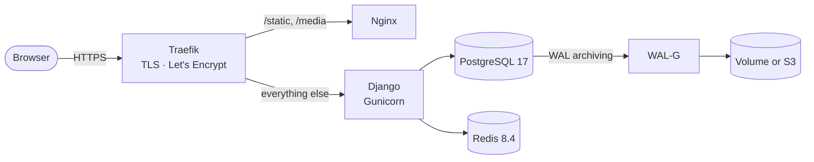

<p align="center">
  
</p>

<h1 align="center">Django Combat</h1>

<p align="center">
  <strong>A battle-ready Django template: generate a project and push it, and it deploys to your VPS over HTTPS with zero downtime and continuous database backups.</strong>
</p>

<p align="center">
  <a href="https://github.com/h0pers/django-combat-template/actions/workflows/template-validation.yml"></a>
  
  
  
  <a href="https://github.com/astral-sh/uv"></a>
  <a href="https://github.com/astral-sh/ruff"></a>
  <a href="https://github.com/cookiecutter/cookiecutter"></a>
</p>

<p align="center">
  <a href="https://django-combat.readthedocs.io">Docs</a> •
  <a href="#quickstart">Quickstart</a> •
  <a href="#features">Features</a> •
  <a href="#template-options">Options</a> •
  <a href="#architecture">Architecture</a> •
  <a href="#deploying-to-production">Deploy</a> •
  <a href="#contributing">Contributing</a>
</p>

---

## Why Django Combat?

Most Django templates get you as far as `runserver`. Then you still have to work out TLS certificates, reverse proxies, static files, image builds, deploy pipelines, rollbacks and backups yourself.

Django Combat ships those pieces already wired up. You generate a project, add a few GitHub secrets and push to `master`. CI runs your tests, builds the images, publishes them to GHCR and rolls them out to a single VPS with zero downtime. PostgreSQL archives every change, so you can restore the database to any minute.

The aim is a template you can take to production on day one, without needing Kubernetes.

## Features

**🚀 Deployment**
- **Push to deploy.** GitHub Actions builds images, pushes them to GHCR and deploys over SSH once CI passes.
- **Zero-downtime rollouts.** [`docker rollout`](https://github.com/wowu/docker-rollout) brings up the new backend before stopping the old one.
- **Release step.** Migrations, `collectstatic` and the first superuser run once per deploy, before traffic moves to the new version.
- **Automatic HTTPS.** [Traefik](https://traefik.io/) gets Let's Encrypt certificates, redirects `www` to the apex domain and hides the `Server` header.
- **Fast static files.** A separate Nginx container serves `/static/` and `/media/`, so Gunicorn only handles application requests.

**🛡️ Database and reliability**
- **PostgreSQL 17** with [WAL-G](https://github.com/wal-g/wal-g) continuous archiving, nightly base backups and **point-in-time restore**.
- **Optional S3-compatible backup storage** (AWS, Cloudflare R2, MinIO and others) with libsodium encryption.
- **Redis 8.4** cache and sessions through `django-redis`.
- **Database connection pooling** per Gunicorn worker, built into Django 5.2.
- **Optional S3-compatible file storage** for media and static files, with signed URLs for media.
- **Health checks** on every service, with separate liveness (`/api/health/`) and readiness (`/api/health/ready/`) endpoints.
- **Ready for more servers.** Containers keep no local state, so you can run several replicas behind a load balancer.

**🔒 Security defaults**
- HSTS (1 year, preload), secure cookies, SSL redirect and `X-Frame-Options: DENY` in production.
- Secure response headers through the [`secure`](https://github.com/TypeError/secure) middleware.
- Containers run as a non-root user.
- Production refuses to start without `DJANGO_SECRET_KEY` and `DJANGO_ALLOWED_HOSTS`.

**🧰 Developer experience**
- **Python 3.14 and [uv](https://github.com/astral-sh/uv)** with a locked, reproducible dependency set.
- **Split settings** (`development` / `production` / `test`), switched with one `DJANGO_ENV` variable.
- **Multi-stage Dockerfile** with separate `development`, `test` and `production` targets and a BuildKit cache.
- **Hot reload** in Docker with your source code mounted.
- **Ruff, pre-commit, pytest and coverage** set up from the start.
- **Every option combination is tested.** The template's own CI generates, lints, builds and tests all 8 variants on every push.

**🧩 Optional integrations**
- **Django REST Framework** with [drf-spectacular](https://github.com/tfranzel/drf-spectacular) OpenAPI docs.
- **Wagtail 7** CMS.
- **Vue 3 SPA** with Vite 7, Tailwind CSS 4, Pinia, Vue Router and [shadcn-vue](https://www.shadcn-vue.com/)-style components, built into the production image.

## Quickstart

**Prerequisites:** [uv](https://docs.astral.sh/uv/getting-started/installation/), [Docker](https://docs.docker.com/get-docker/) with Compose v2, and git. You also need Node.js 22+ if you choose Vue.

```bash
# 1. Generate a project (answer the prompts)
uvx cookiecutter gh:h0pers/django-combat-template

# 2. Configure the environment
cd my-django-project
cp .env.example .env

# 3. Start the stack with hot reload
docker compose -f docker-compose.debug.yml up --build
```

Open **http://localhost**. On first start the stack creates a superuser from the `DJANGO_SUPERUSER_*` values in `.env` (`admin` / `admin` by default). Log in at **http://localhost/admin/**.

| URL | What's there |
|---|---|
| `/admin/` | Django admin |
| `/api/health/` | Liveness check |
| `/api/health/ready/` | Readiness check (PostgreSQL and Redis) |
| `/api/docs/` | Swagger UI (with DRF, only when `DEBUG` is on) |
| `/cms/` | Wagtail admin (with Wagtail) |
| `/app/` | Vue SPA (with Vue) |

The generation step also runs `uv lock`, `git init` and an initial commit for you.

## Template Options

| Option | Default | Description |
|---|---|---|
| `project_name` | `My Django Project` | Human-readable project name |
| `project_slug` | *derived* | Directory and package name, derived from `project_name` |
| `description` | `A Django project` | Short project description |
| `author_name` | `Your Name` | Author name |
| `use_drf` | `y` | Django REST Framework, drf-spectacular and an example `polls` API |
| `use_wagtail` | `n` | Wagtail CMS with a starter home page |
| `use_vue` | `n` | Vue 3 + Vite + Tailwind SPA served by Django through `django-vite` |

To skip the prompts, pass the options on the command line:

```bash
uvx cookiecutter gh:h0pers/django-combat-template --no-input \
  project_name="Acme Store" use_drf=y use_wagtail=n use_vue=y
```

## Architecture



<details>
<summary><strong>What the generated project looks like</strong></summary>

```text
my-django-project/
├── .github/workflows/      # ci.yml · deploy.yml · pre-commit.yml
├── docker/
│   ├── nginx/              # static and media server image
│   └── postgres/           # PostgreSQL + WAL-G backup scripts
├── frontend/               # Vue 3 + Vite (only with use_vue)
├── website/
│   ├── apps/
│   │   ├── core/           # health check, security middleware
│   │   ├── polls/          # example API and SPA (DRF / Vue)
│   │   └── cms/            # Wagtail pages (only with use_wagtail)
│   └── website/settings/
│       ├── components/     # base, database, cache, security, ...
│       └── environments/   # development · production · test
├── Dockerfile              # development / test / production targets
├── docker-compose.yml        # production
├── docker-compose.debug.yml  # local development
├── docker-compose.test.yml   # test runner
└── pyproject.toml          # uv-managed dependencies + Ruff config
```

</details>

## Deploying to Production

Deployment targets a single Linux VPS that runs Docker and a shared Traefik instance.

> [!TIP]
> **Recommended: provision the server with [vps-infra](https://github.com/h0pers/vps-infra).** It's a companion Ansible collection that turns a fresh Ubuntu 24.04 VPS into exactly the host Django Combat expects. It sets up Docker, `docker rollout`, a shared Traefik with Let's Encrypt, and one deploy user per app. It also hardens the server with iptables rate limits, fail2ban, unattended security upgrades and no root or password SSH. One server can host many Django Combat projects.

1. **Prepare the server.** With [vps-infra](https://github.com/h0pers/vps-infra), add your app as a deploy user in the inventory and run the playbook.
   <details>
   <summary>Setting up the server by hand instead</summary>

   Install Docker and the [`docker rollout`](https://github.com/wowu/docker-rollout) plugin. Run Traefik on an external `traefik-public` network with a `websecure` entrypoint and a `le` certificate resolver. Create a non-root user in the `docker` group for deploys.

   </details>
2. **Point your domain** (and `www`) at the server with an A record.
3. **Add GitHub secrets** to the `production` environment: `VPS_HOST`, `VPS_USER` (the deploy user), `SSH_PRIVATE_KEY`, `DJANGO_SECRET_KEY`, `POSTGRES_USER`, `POSTGRES_PASSWORD`, `POSTGRES_DB`, `PACKAGES_TOKEN`, plus the `MY_DOMAIN` variable.
4. **Push to `master`.** CI tests the project, and then the deploy workflow builds, publishes and rolls out the new version.

The generated project's README and the [docs](https://django-combat.readthedocs.io) cover the full guide: the one-time systemd setup, Gunicorn tuning, files and backups in S3, running on more servers and the step-by-step restore procedure.

## Contributing

Contributions are welcome: bug reports, ideas and pull requests.

1. Fork the repo and create a branch (`feat/...`, `fix/...`).
2. Generate a project with your changes to check them: `uvx cookiecutter . --no-input`.
3. Open a pull request. CI validates all 8 option combinations.

Commit messages follow [Conventional Commits](https://www.conventionalcommits.org/). See [CONTRIBUTING.md](CONTRIBUTING.md) for the full guide.

Please follow the [Code of Conduct](CODE_OF_CONDUCT.md). Questions go through [SUPPORT.md](SUPPORT.md), and vulnerabilities through [SECURITY.md](SECURITY.md).

## Acknowledgements

Built on the shoulders of [Django](https://www.djangoproject.com/), [Cookiecutter](https://github.com/cookiecutter/cookiecutter), [uv](https://github.com/astral-sh/uv), [Traefik](https://traefik.io/), [WAL-G](https://github.com/wal-g/wal-g) and [docker-rollout](https://github.com/wowu/docker-rollout), and inspired by [cookiecutter-django](https://github.com/cookiecutter/cookiecutter-django).

<p align="center">
  If Django Combat saves you a weekend of DevOps, consider giving it a ⭐
</p>
