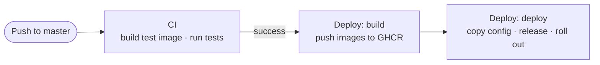

# About the deploy pipeline

A push to `master` goes through two GitHub Actions workflows before it reaches the server.

## Build once, run the same image

CI builds the `test` target of the Dockerfile and runs the tests inside it. The deploy workflow then builds the `production` target and pushes it to the GitHub Container Registry. The server never builds anything. It pulls images, so what runs in production is exactly what the workflow built. A slow or small server doesn't slow down deploys.

## What happens on the server

1. The workflow writes `.env` and `walg.env` from the repository's secrets and copies them, together with `docker-compose.yml`, to the server. Secrets stay in GitHub, and the server only holds the current copy.
2. It pulls the new images and starts PostgreSQL, the backup scheduler, Redis and Nginx if they aren't already running.
3. It runs `docker-release.sh` in a one-off container from the new image, before any traffic reaches the new code. The script applies migrations, runs `collectstatic` and creates the first superuser if the database has no users.
4. It runs `docker rollout backend`. This starts a second backend container next to the old one, waits until the new one passes its health check on `/api/health/`, and then stops the old one. Traefik sends requests to whichever containers are healthy, so no request finds the site down.

## Why a separate release step

Migrations, `collectstatic` and creating the first user change shared state: the database and the static files. They need to run once per deploy. If every backend container ran them on start, two containers starting together would race to apply the same migration, and each extra replica would repeat the work. So the production container only starts Gunicorn, and the release script runs once before the rollout.

The development stack has a single container, so it runs the same script on every start for convenience.

## Why migrations run first

Running migrations before the rollout means the new code never starts against an old schema. For a short time, though, the old code runs against the new schema. Migrations therefore need to be backward compatible: add a column before you use it, and remove it only after no running code reads it. Django Combat doesn't enforce this. It's a habit to build when you write migrations.

## Why `docker rollout` and not Swarm or Kubernetes

Zero-downtime deploys usually mean an orchestrator. [docker rollout](https://github.com/wowu/docker-rollout) is a small Docker CLI plugin that gives Compose the one feature needed here, replacing a service without a gap. It keeps the stack in plain Compose files that you can read and run anywhere.

## Related

- {doc}`production-stack`
- {doc}`scaling`
- {doc}`../reference/github-settings`
