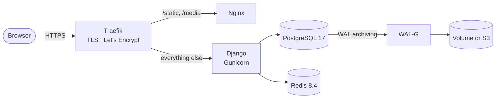

# About the production stack

A generated project runs as a handful of containers on one server, behind a Traefik instance that the server shares with other apps.

## Why one server

Most small and medium Django apps fit on a single VPS. One server is cheaper, has fewer moving parts, and is easier to debug than a Kubernetes cluster or a managed platform. Docker Compose describes the whole stack in one file that you can also run on your laptop.

The cost is that the server is a single point of failure. Django Combat covers the part that matters most, the data, with continuous backups that you can store off the server. If the server dies, you rebuild it and restore the database. You don't keep a standby running.

The app itself doesn't depend on running on one server. {doc}`scaling` describes what's ready for more servers and what's left to you.

## Why Traefik in front

Traefik reads the labels on each container and routes requests to it. It also gets and renews Let's Encrypt certificates on its own. Because it's shared, one server can host several Django Combat projects, each with its own domain, without editing a central configuration file. The project's labels also redirect `www` to the bare domain and remove the `Server` response header.

## Why a separate Nginx for files

Gunicorn workers are expensive. Each one handles a single request at a time. If Django served `/static/` and `/media/` itself, a page with many images would tie up workers that application requests need. A small Nginx container serves those paths straight from shared volumes, and Traefik sends them there before they reach Django.

[WhiteNoise](https://whitenoise.readthedocs.io/) is a common alternative for static files, but it doesn't serve uploaded media and it still runs inside the Gunicorn workers.

When files are stored in S3, as in {doc}`../how-to/store-files-in-s3`, Django builds URLs that point at the bucket or a CDN. Browsers then fetch files from there, and Nginx no longer receives those requests.

## Security defaults

Production settings turn on HSTS for a year with preload, secure cookies, an HTTPS redirect and `X-Frame-Options: DENY`. The `secure` middleware adds more response headers. Containers run as a non-root user. Production settings refuse to start without `DJANGO_SECRET_KEY` and `DJANGO_ALLOWED_HOSTS`, so a missing secret fails loudly instead of running with an unsafe default.

## Related

- {doc}`deploy-pipeline`
- {doc}`backups`
- {doc}`scaling`
- {doc}`../how-to/deploy-to-a-vps`
